<picture>
  <source media="(prefers-color-scheme: dark)" srcset="./assets/hero-dark.svg" />
  
</picture>

  
  

<h3 align="center">Hi, I'm Taiheng. I make the best.</h3>

I work on reinforcement learning for LLMs, memory for long-running agents, and evaluation that holds up under a second look. Everything below ships with code you can run today.

##  What I've built

- **[Probe the Harness](https://github.com/pth2002/probe-the-harness)**   My new RL method won every run, so I audited the training harness and found four bugs propping it up. PTH runs the same four checks on your verl logs in one command.
- **[RL Method Tracker](https://github.com/pth2002/rl-method-tracker)**   Which RL post-training methods for language models actually reach open-source training frameworks. Of 1,598 methods on arXiv, 37 reached framework code. The tracker updates every week.
- **[ConvMemory](https://github.com/pth2002/ConvMemory)**    A 14 MB reranker for agent memory. On LoCoMo it beats both BGE cross-encoders and lands within 2% of mxbai-rerank-large's MRR while running 68 times faster.
- **[repofit](https://github.com/pth2002/repofit)**   Reads what your coding agents already know about you and picks the GitHub projects you will actually use. It runs inside your agent as an MCP server, with no API key.
- **[FinPilot](https://github.com/pth2002/FinPilot)** Qwen2.5-3B trained with SFT and then DPO into an A-share investing assistant. A GPT-4o judge preferred its answers 74% of the time.
- **[BiLegalContract-RAG-Tool](https://github.com/pth2002/BiLegalContract-RAG-Tool)** A contract assistant for Chinese, English or both. Clause-aware chunking alone lifted Chinese Recall@5 by 93%.

##  Toolbox

  <picture>
    <source media="(prefers-color-scheme: dark)" srcset="./assets/stack-icons-dark.svg" />
    
  </picture>

##  A year of building

<picture>
  <source media="(prefers-color-scheme: dark)" srcset="https://raw.githubusercontent.com/pth2002/pth2002/output/contributions-dark.svg" />
  
</picture>

Redrawn every day by GitHub Actions from my contribution calendar.

